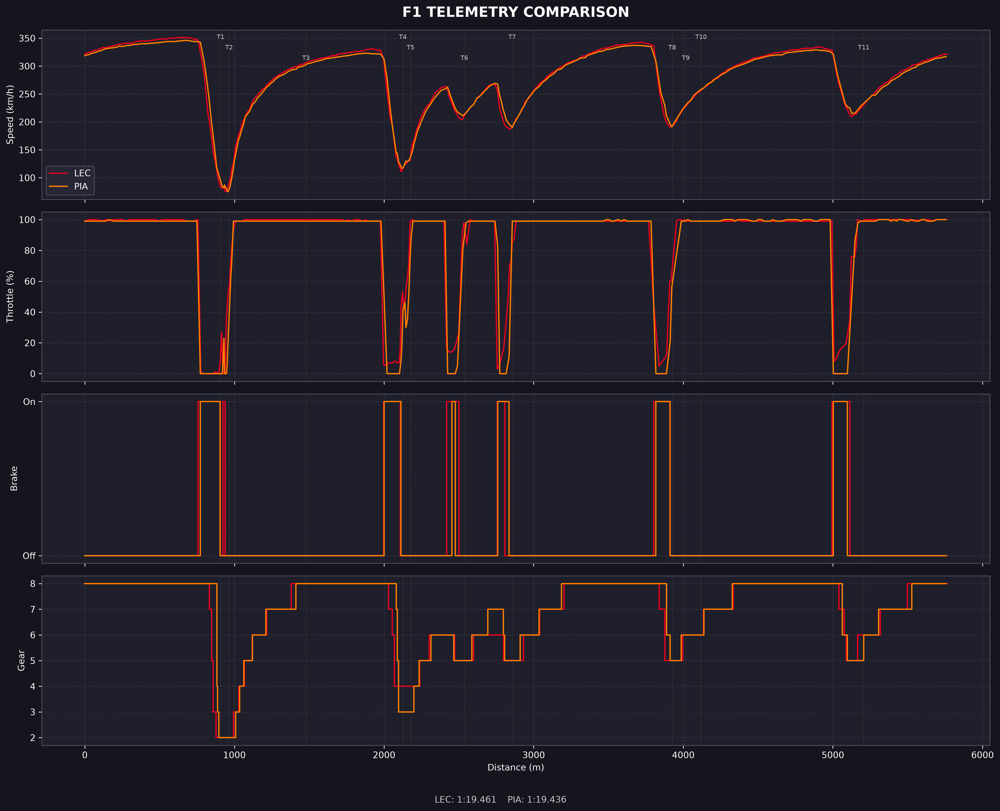
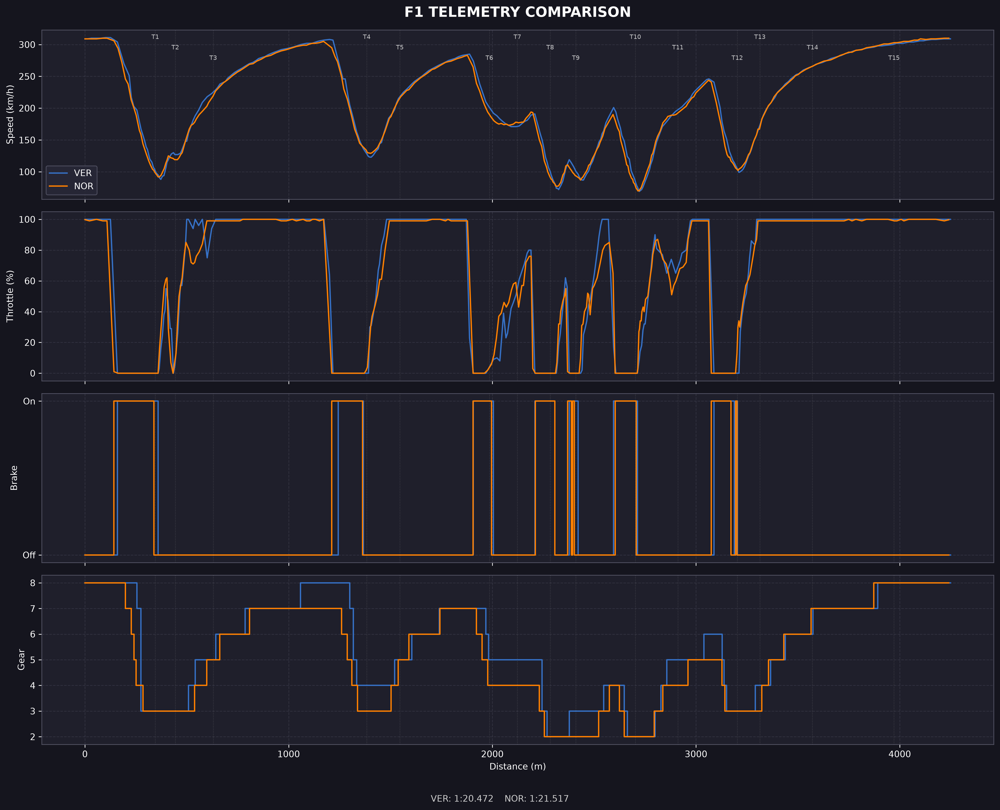

# F1 Telemetry Analyzer

A Python tool for comparing Formula 1 driver telemetry using data from [OpenF1](https://openf1.org/).

The project retrieves lap and car telemetry, compares two drivers, and generates a graph showing their speed, throttle, braking, and gear changes. It also adds circuit corner markers to help identify where drivers gain or lose time.

## Example results

### Monza — 2024 Qualifying



### Brazil — 2024 Race



## Features

- Compare the fastest laps of two drivers.
- Plot speed, throttle, brake, and gear data.
- Display circuit corner markers on telemetry graphs.
- Use team colours to distinguish drivers.
- Support practice, qualifying, sprint, and race sessions.
- Cache API responses locally to reduce repeated requests.
- Automatically retrieve circuit corner information.

## Requirements

Before starting, make sure you have:

- Python 3.10 or newer
- Git
- An internet connection
- A Windows, macOS, or Linux computer

The project uses the OpenF1 API and does not require an API key for the endpoints used here.

## Installation

Follow the instructions for your operating system.

### 1. Clone the repository

Open PowerShell or a terminal and run:

```bash
git clone https://github.com/YOUR_USERNAME/f1-telemetry-analyzer.git
```

Move into the project folder:

```bash
cd f1-telemetry-analyzer
```

Replace `YOUR_USERNAME` with the GitHub username of the repository owner.

### 2. Create a virtual environment

A virtual environment keeps this project's Python packages separate from other projects.

**Windows PowerShell:**

```powershell
python -m venv .venv
```

**macOS / Linux:**

```bash
python3 -m venv .venv
```

### 3. Activate the virtual environment

**Windows PowerShell:**

```powershell
.\.venv\Scripts\Activate.ps1
```

If PowerShell blocks the activation script, run this command in the same terminal:

```powershell
Set-ExecutionPolicy -Scope Process -ExecutionPolicy Bypass
```

Then activate the environment again:

```powershell
.\.venv\Scripts\Activate.ps1
```

**Windows Command Prompt:**

```cmd
.venv\Scripts\activate.bat
```

**macOS / Linux:**

```bash
source .venv/bin/activate
```

After activation, you should see `(.venv)` at the beginning of your terminal prompt.

### 4. Install dependencies

Make sure the virtual environment is active, then run:

```bash
python -m pip install --upgrade pip
```

Install the required packages:

```bash
python -m pip install -r requirements.txt
```

This installs:

- `requests` — API requests
- `pandas` — telemetry data handling
- `numpy` — numerical calculations
- `matplotlib` — telemetry graphs

Wait until the installation finishes before continuing.

## Running the analyzer

### Your first telemetry comparison

Once installation is complete, run:

```bash
python analyze_telemetry.py
```

This uses the default settings:

| Option | Default |
|---|---|
| Year | 2024 |
| Grand Prix | Monza |
| Session | Qualifying |
| Driver 1 | LEC |
| Driver 2 | PIA |
| Output | telemetry_comparison.png |

When the analysis finishes, the graph will be saved in the project folder as:

```text
telemetry_comparison.png
```

Open the PNG file to view the comparison.

### Run a custom comparison

You can change the year, event, session, drivers, and output filename.

Example — 2024 Monza Qualifying, Charles Leclerc vs Oscar Piastri:

```bash
python analyze_telemetry.py --year 2024 --gp Monza --session Q --d1 LEC --d2 PIA --out monza_comparison.png
```

Example — 2024 Brazil Race, Max Verstappen vs Lando Norris:

```bash
python analyze_telemetry.py --year 2024 --gp Brazil --session R --d1 VER --d2 NOR --out brazil_comparison.png
```

The output filename can be whatever you want, as long as you use a `.png` extension.

## Command-line options

| Argument | Description | Example |
|---|---|---|
| `--year` | Championship year | `--year 2024` |
| `--gp` | Grand Prix or event name | `--gp Monza` |
| `--session` | Session type | `--session Q` |
| `--d1` | First driver's acronym | `--d1 LEC` |
| `--d2` | Second driver's acronym | `--d2 PIA` |
| `--out` | Output image filename | `--out result.png` |

### Supported session types

| Code | Session |
|---|---|
| `FP1` | Free Practice 1 |
| `FP2` | Free Practice 2 |
| `FP3` | Free Practice 3 |
| `Q` | Qualifying |
| `S` | Sprint |
| `R` | Race |

Use the session code exactly as shown.

## Finding driver codes

Not sure which driver acronyms to use?

Run:

```bash
python list_drivers.py
```

This lists the drivers available for the default 2024 Monza Qualifying session, including their numbers, acronyms, names, and teams.

Use the displayed acronym with `--d1` or `--d2`.

For example:

```bash
python analyze_telemetry.py --d1 VER --d2 HAM
```

The driver codes must belong to the selected session.

## Testing the API connection

To check whether the API connection and core telemetry functions are working, run:

```bash
python test_openf1.py
```

The test script checks:

- Session lookup
- Driver telemetry retrieval
- Fastest lap information
- Circuit corner retrieval

A successful test prints the session details, telemetry preview, and circuit corner information.

## Understanding the graph

The generated graph contains four telemetry panels:

1. **Speed:** Vehicle speed throughout the lap, measured in km/h.
2. **Throttle:** How much throttle the driver applies, expressed as a percentage.
3. **Brake:** Indicates whether the driver is braking.
4. **Gear:** The gear selected throughout the lap.

The vertical markers identify circuit corners. The corner labels help you relate telemetry changes to specific parts of the track.

The distance axis represents estimated distance travelled around the lap.

## How caching works

API responses are stored locally in the `openf1_cache/` directory.

- Cached responses are reused for up to 24 hours.
- This reduces unnecessary API requests.
- Expired responses are retrieved again.
- Cache files are generated automatically.

You do not need to create the cache folder manually.

If you want to retrieve fresh data immediately, you can close the program and delete the `openf1_cache/` folder. It will be recreated automatically when needed.

## Troubleshooting

### 1. Python is not recognized

If you see:

```text
'python' is not recognized as an internal or external command
```

Install Python and make sure it is added to your system PATH.

On Windows, you can also try:

```powershell
py --version
```

If that works, use `py` instead of `python` in the commands.

### 2. Git is not recognized

If you see:

```text
'git' is not recognized
```

Install Git for your operating system, restart your terminal, and check:

```bash
git --version
```

### 3. ModuleNotFoundError

For example:

```text
ModuleNotFoundError: No module named 'pandas'
```

Make sure your virtual environment is activated, then run:

```bash
python -m pip install -r requirements.txt
```

### 4. PowerShell blocks virtual environment activation

Run:

```powershell
Set-ExecutionPolicy -Scope Process -ExecutionPolicy Bypass
```

Then try activation again:

```powershell
.\.venv\Scripts\Activate.ps1
```

This changes the execution policy only for the current PowerShell session.

### 5. No matching session found

Check that:

- The year is correct.
- The event name is spelled correctly.
- The requested session took place that year.
- The session code is one of the supported codes.

For example:

```bash
python analyze_telemetry.py --year 2024 --gp Monza --session Q
```

If an event name matches multiple sessions or events, use a more specific event name.

### 6. API request failed or rate limit reached

The project uses the public OpenF1 API.

If a request fails:

- Check your internet connection.
- Wait a little before trying again.
- Avoid running several copies of the analyzer at the same time.
- Try again later if the API is temporarily unavailable.

The client includes retry handling for temporary request failures and API rate limits.

### 7. Graph or circuit corner information is incomplete

Telemetry distance is estimated from the available speed samples. It may not exactly match the official circuit length.

Circuit corner information is retrieved separately from the MultiViewer circuit API. If that service is unavailable, the telemetry graph can still be generated without corner annotations.

## Project structure

```text
f1-telemetry-analyzer/
│
├── analyze_telemetry.py
├── openf1_client.py
├── test_openf1.py
├── list_drivers.py
│
├── requirements.txt
├── README.md
├── LICENSE
├── .gitignore
│
├── monza_corner_analysis_v3.png
└── brazil_corner_analysis.png
```

Generated cache files and virtual environment files are not included in the repository.

## Data sources

- [OpenF1 API](https://openf1.org/) — session information, driver information, laps, and car telemetry.
- [MultiViewer](https://multiviewer.app/) — circuit corner information.

## Limitations

- Telemetry availability depends on the selected session and the data provided by OpenF1.
- Distance is estimated from sampled speed data and is not an official GPS measurement.
- The analyzer compares fastest laps; it is not a complete race strategy or tire degradation simulator.
- Internet access is required when the necessary data is not available in the local cache.

## License

This project is licensed under the MIT License. See [LICENSE](LICENSE) for details.